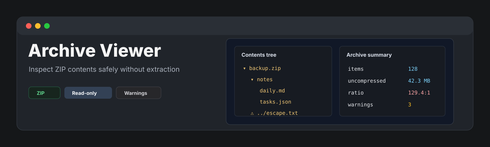
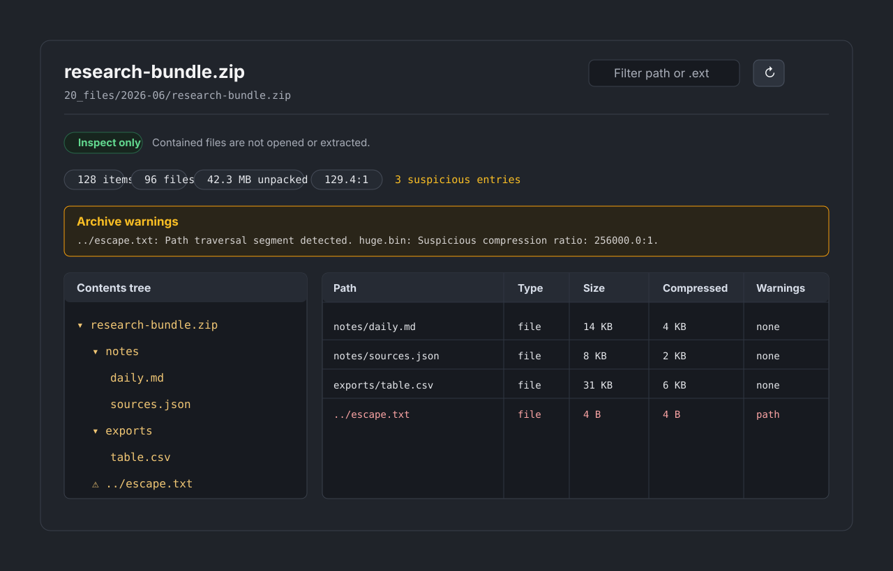

<p align="center">
  
</p>

<p align="center">
  <a href="https://github.com/viggomeesters/obsidian-archive-viewer/releases/latest"></a>
  <a href="LICENSE"></a>
  
  
</p>

# Archive Viewer

Archive Viewer is a read-only plugin for inspecting `.zip` archive contents inside a vault. It shows the ZIP central-directory metadata as a contents tree and table without extracting files.



## Features

- Registers `.zip` files for v0.1.
- Shows archive paths as a folder/file tree.
- Displays entry metadata: path, file or folder type, size, compressed size, modified date, compression method, and warnings.
- Shows archive summary: item count, file count, folder count, total uncompressed size, total compressed size, compression ratio, and suspicious entry count.
- Filters by path text or extension, including searches such as `.json`.
- Refreshes metadata after external file changes.
- Warns about path traversal, absolute paths, hidden/system-looking paths, encrypted entries, huge uncompressed size, suspicious compression ratios, and many-file archives.
- Caps rendered listings at 2,000 entries to keep the view responsive.

## Scope

Archive Viewer v0.1 supports `.zip` only. `.tar`, `.gz`, `.tgz`, `.rar`, and `.7z` are intentionally deferred until a parser choice can be made without weakening the read-only model.

This is an archive inspector, not an archiver, extractor, restore tool, backup tool, export tool, or file manager. It never extracts archive contents to disk, never opens contained files, never renames or deletes files, never writes archive files back, and never attempts password cracking or decryption.

## Safety model

Archive Viewer reads only ZIP central-directory metadata through the vault binary API. It does not decompress entry contents and does not expose an extraction path in the UI.

The plugin does not use runtime network APIs, clipboard APIs, subprocess APIs, dynamic code evaluation, or archive write-back behavior.

## Community plugin compliance

The repository is prepared for Obsidian Community plugin review:

- `manifest.json.id` is `archive-viewer`, contains only lowercase letters and hyphens, does not contain `obsidian`, and does not end with `plugin`.
- `manifest.json.name` is short, English, Basic Latin, and does not include `Obsidian`.
- `manifest.json.version` is `0.1.0` in `x.y.z` format.
- `versions.json` maps `0.1.0` to the minimum app version.
- Release assets are `main.js`, `manifest.json`, and `styles.css`.
- Runtime plugin code avoids Node.js, Electron, network, clipboard, subprocess, and dynamic evaluation APIs.
- The release workflow can attest the release assets with GitHub artifact attestations.

## Parser dependency decision

The v0.1 parser has no archive parser dependency. A small TypeScript ZIP central-directory reader is used instead because general unzip libraries often include extract/decompress APIs that are outside this plugin's scope. Keeping the parser metadata-only makes the hard non-goals easier to verify.

## Existing plugin positioning

Existing community archive-related plugins were considered:

- [Archive File](https://community.obsidian.md/plugins/archive-file) moves notes into an archive folder.
- [Differential ZIP Backup](https://community.obsidian.md/plugins/diffzip) creates and restores ZIP backups.
- [Export Markdown ZIP](https://community.obsidian.md/plugins/export-markdown-zip) exports markdown files to ZIP.
- [Course Module Loader](https://community.obsidian.md/plugins/course-module-loader) downloads and unzips course materials.

Archive Viewer is different by design: it only inspects an existing local `.zip` file as metadata and does not archive, export, back up, restore, download, unzip, or extract anything.

## Installation

### Manual installation

1. Download `main.js`, `manifest.json`, and `styles.css` from a release.
2. Create this folder in your vault: `.obsidian/plugins/archive-viewer/`.
3. Put the downloaded files in that folder.
4. Reload the app.
5. Enable **Archive Viewer** in community plugin settings.

### BRAT installation

For beta testing, install the plugin with [BRAT](https://github.com/TfTHacker/obsidian42-brat) using this repository URL:

```text
https://github.com/viggomeesters/obsidian-archive-viewer
```

## Usage

Open any `.zip` file in your vault. The file opens with Archive Viewer.

Use the toolbar to filter paths or extensions and refresh metadata after file changes.

## Development

```bash
npm install
npm run build
npx tsc --noEmit
npm test
```

The fixture set covers simple ZIPs, nested folders, path traversal entries, many-file archives, large-size metadata, and malformed input.

## Release process

1. Update `manifest.json`, `package.json`, and `versions.json`.
2. Run `npm install`, `npm run build`, `npx tsc --noEmit`, and `npm test`.
3. Create a GitHub release whose tag exactly matches `manifest.json.version`.
4. Attach `main.js`, `manifest.json`, and `styles.css` as release assets.

## Community directory

Archive Viewer is listed in the [Obsidian Community directory](https://community.obsidian.md/plugins/archive-viewer).

## License

[MIT](LICENSE)
